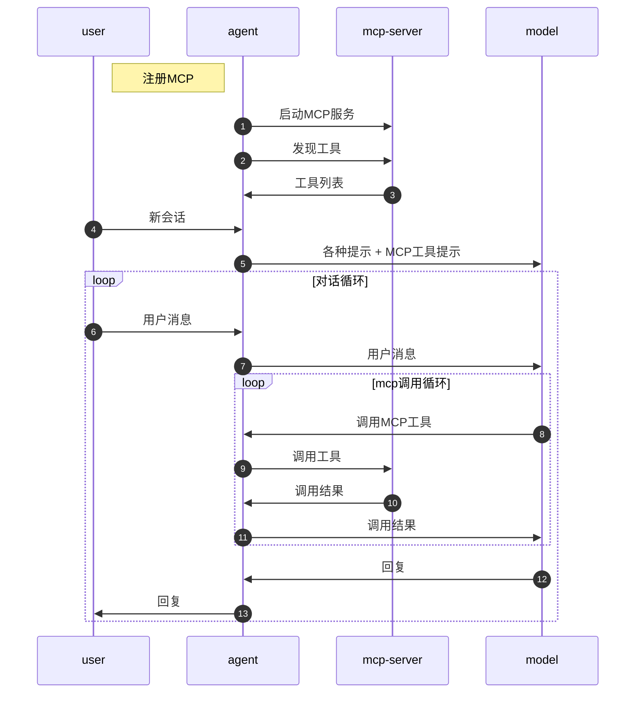
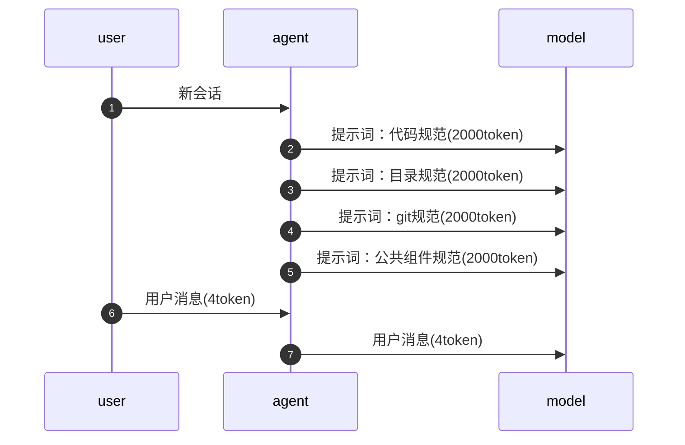

# Agent基础
## Raw Model

剥离了花里胡哨的功能，看到AI最真实的本质

知识体系上是非常稳定的

简单理解：就是一个函数，接收一个输入，产生一个输出

->输入的是一个Token 列表(可以理解为一个数组)

->Token是什么？是自然语言换算成数字的结果（过程称为分词）

->输出一个概率分布 是下一个token的概率

### 上下文窗口 Context Window

指的是Token列表的长度

指最多能处理多少个Token

->但不代表这么多个Token都能处理好

### 权重矩阵

Raw Model里面在调一个权重矩阵

本质上是由浮点数组成的<font style="color:#DF2A3F;">多维数组</font>

我们所说的模型有多少个参数，指的就是这个矩阵的数字的数量

平常所说的模型训练，就是指得到这么一个矩阵的过程

->模型训练，微调，都是基于这个矩阵

->其原材料是<font style="color:#DF2A3F;">语料</font>


多模态：无论是视频图片，音频，最终输入的都是数组，其实并没有本质的区别

过程：传入一个Token List，根据权重矩阵里面的参数，来进行运算，最后得到下一个Token的概率分布

## Model Service

一般是由模型的服务商 提供的API接口

接口的规格，不同的服务商不一样

openAI的API是行业内的<font style="color:#DF2A3F;">事实标准</font>

<font style="color:#DF2A3F;">前处理</font>

- 身份/权限认证
- 提示词注入
- tokenization 分词 token化

<font style="color:#DF2A3F;">自回归</font>：传入token list，调用Raw Model，得到输出，再追加进输入里，得到新的输出

影响选择token的配置：

- temperature：影响选择的随机性，0\~2 数值越大，随机性越大
- top\_k：在概率分布中截断，按照概率从高到低排位，取多少位
- top\_p：核采样，按照总体的概率来进行采样（累加概率到某个数值）

<font style="color:#DF2A3F;">后处理</font>

- Detokenization  反token化 把token变成自然语言
- 合规性检查


## 工具使用

### 工具选择

IDE + Coding Agent + 模型

1. IDE集成：VSCode、Cursor、Trae、....
2. IDE + Coding Agent + 模型：
   - Coding Agent：`Claude Code`、`Codex`、`OpenCode`、....
   - 模型：`Claude Sonnet`、`Claude Opus`、`Codex`、`Gemini`、`Kimi`、`GLM`、`Minimax`、...

### Coding Agent原理

#### tools

```shell
总结一下这个项目在干什么 ---> 大模型 ---> ????
```

Coding Agent

1. 加提示词
   - 告诉大模型，目前项目代码的路径
   - 告诉大模型，可以使用哪些工具
2. 将用户问题和提示词一起传递给大模型
3. 大模型根据情况决定是否要使用工具。当需要使用工具的时候，它会返回一个JSON格式
4. Agent, 它就会拿到这个JSON格式，然后根据JSON格式的内容决定接下来如何处理?
5. Agent将执行的结果，然后返回给模型，又输入给大模型
6. 后续呢，继续交互性的操作，就大模型跟Agent之间不停的交互，直到得得到一个最终的答案

常用工具：

- command
- read
- write
- delete

#### 会话

conversation / session / thread

在同一个会话里边，每一次用户发消息都要把之前的所有历史消息内容全部带上

会话是什么？

- 会话解决了什么问题：大模型其实是没有状态的，所谓的记忆呢，全靠agent把上下文历史打包重新发一遍

会带来什么样的问题呢？

- 之前读过的文件内容，调用工具的json都会重新发一遍，导致上下文膨胀，费用和延迟都会增长

#### 提示词

全局提示词：常驻的系统提示词

工程提示词：表现为AGENTS.md,用来规范当前工程的细节，如使用的技术栈等

作用：精简上下文，让模型不用每次都去猜，或者每次都把项目读一遍

#### 深度思考/推理/思维链

用户问题 ---> 模型 ---> 回复

用户问题 ---> 模型 ---> 思考过程 ---> 模型 ---> 确定性更高的回复

- 要解决什么问题：模型每轮"输入 → 输出"有个隐含事实 —— 模型是"一句话生成一句话"的 ，它生成第一个词时，后面的词还没想好。又因为模型的输出是基于概率的，极容易跑偏
- 深度思考做了什么：让模型先别急着给答案，先在内部把思考过程写一遍，再基于这份思考给最终答案。
- 代价：更慢（多轮思考）更贵（token消耗多了）

#### MCP

可以简单的理解为：MCP就是一个tool的集合



#### Skill

Skill最初要解决的问题是提示词过大的问题。它第一次引入了**渐进式**提示方案。

Skill 本身是一份详细的文档；它只有<font style="color:#DF2A3F;">索引</font>常驻在提示词里；Agent 判断需要时，才把文档全文加载进上下文。目的是用"按需取阅"换掉"每轮全发"，避免提示词过大。

**无渐进式方案：**



**渐进式方案：**


skill商店：<https://skills.sh/>

安装一个find  skill:可用于在agent内部寻找skill

#### Sub Agent

子代理拥有独立的：提示词、会话上下文\[、skills、tools、权限边界...]

子代理的优势：

- 独立会话，不污染主代理上下文
- 可并行执行，缩短任务总时长
- 能力专注，更适合专项任务

Coding Agent一般会有两种形式的子代理：

- 内置子代理：系统内置的代理，不同厂商设置不同，用户无法干预
- 用户子代理：用户启动的子代理，通常用于完成各种并行、独立的开发任务，需要用户用提示词启动

#### 长期记忆

Coding Agent 有内置的长期记忆系统，会记录和用户的沟通过程中沉淀的经验和教训。

### 开发范式

vibe coding: 氛围编程

spec coding：SDD, Spec-driven development 规范驱动开发

> spec coding 是一个过渡产物

- Spec-kit
- OpenSpec
- SuperPowers

### 最佳实践

1. 每一个会话应该保持独立和连续。（尽量减少会话中的内容）
2. 提示词始终保持精简
3. 文档尽量的细粒度拆分
4. skill数量不宜超过12个
5. 独立、并行任务适合使用子代理完成
6. 奖罚分明，有利于形成长期记忆

